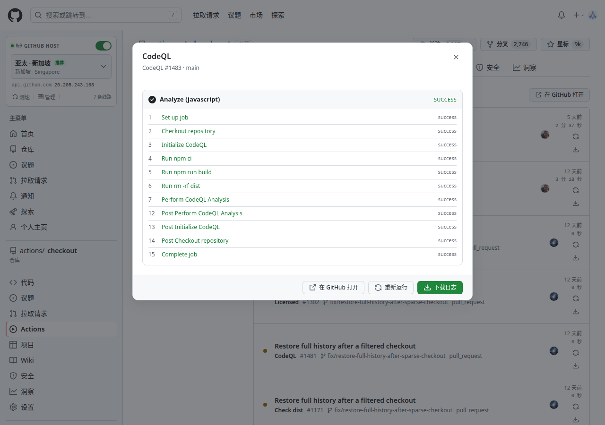
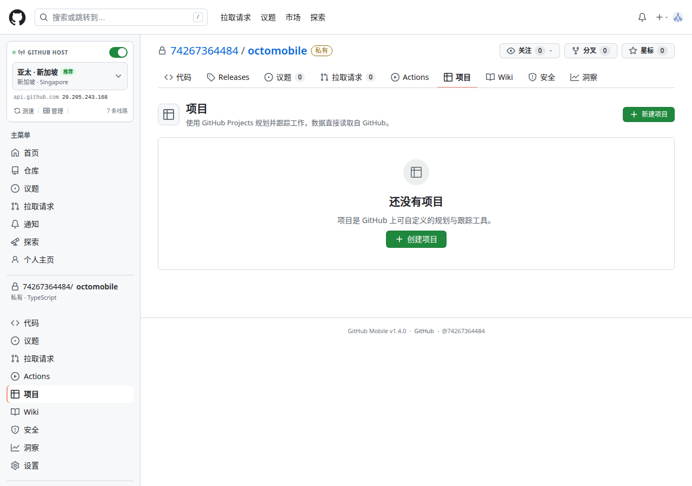
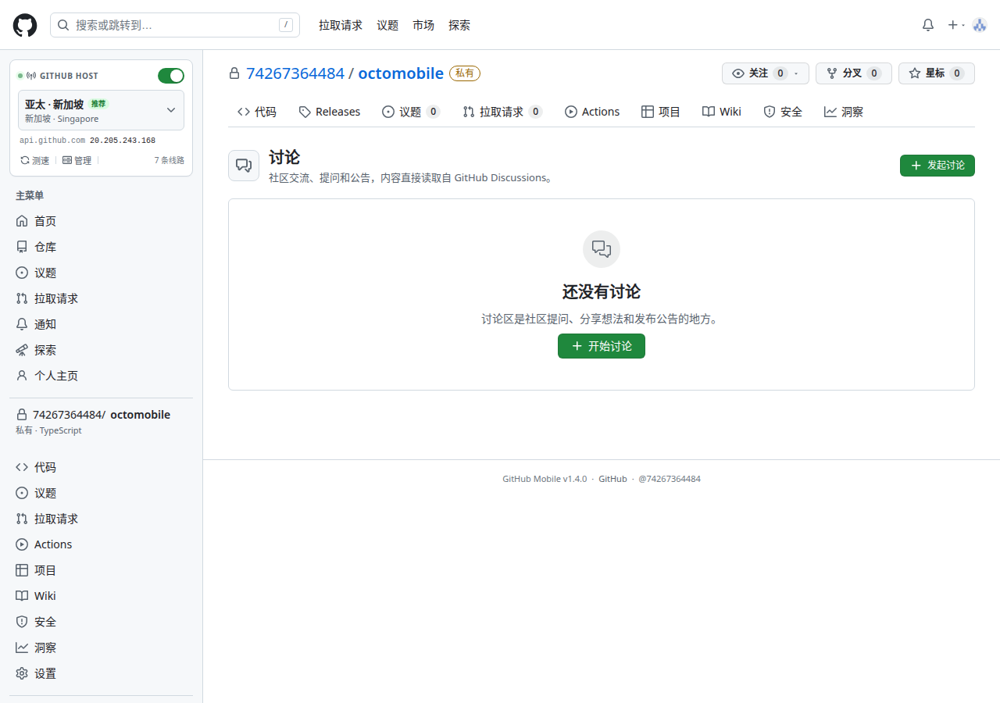
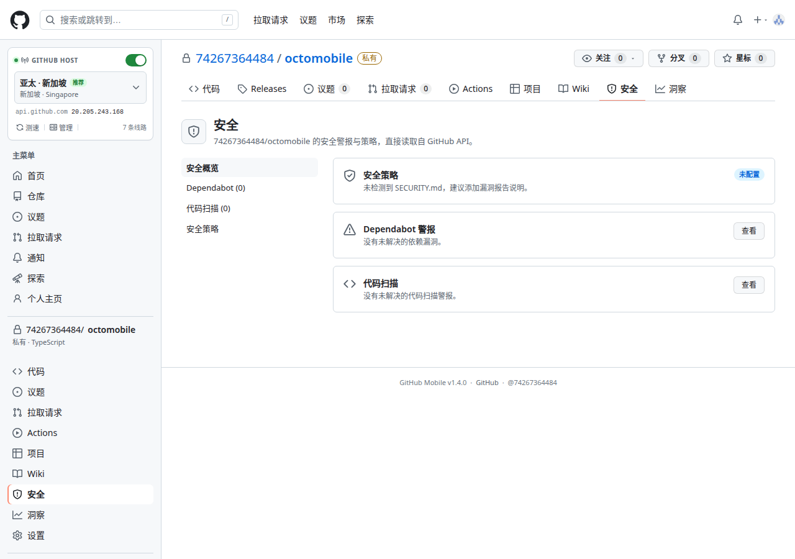
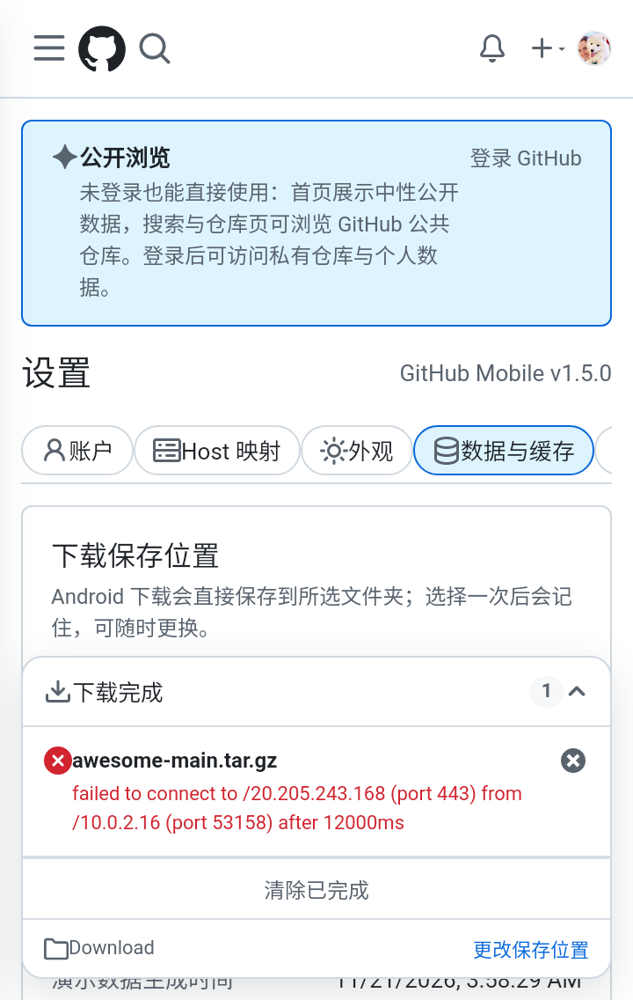

# GitHub Mobile · 非官方客户端

> 按 GitHub 网页视觉与信息架构重写的 Android 客户端。无需登录即可进入浏览公开内容，登录后访问私有仓库与个人数据；中文界面、真实 GitHub API，左侧导航置顶内置 **Host 映射**（默认开启）。
>
> 独立第三方项目，与 GitHub, Inc. 无隶属关系。GitHub、Octocat 是其商标；本项目的名称仅用于说明兼容目标，不代表官方应用。

   

## 截图

| Releases · 下载区置顶、说明可折叠 | Actions 运行详情（作业/步骤） |
|---|---|
|  |  |
| **项目（GraphQL，应用内）** | **讨论（列表/展开/发布）** |
|  |  |
| **安全警报（应用内）** | **更改下载保存位置** |
|  |  |

---

## 下载

- 最新 APK：本仓库 **Releases** 页面的 `GitHubMobile-1.5.0.apk`
- 大小：4,213,778 字节（约 4.0 MB），debug 签名，可直接侧载
- SHA-256：`d2ac28331941d6e169a591f08a13d6b2d91f6851060c593a6bb55e646540ead0`

---

## v1.5.0 更新

- **Releases 下载不再难找**：资源与源码下载区移到发行说明之前，发行说明默认折叠；点击蓝色标签会在页内跳到下载区，不再打开 GitHub 网页。
- **Actions 不再跳网页**：点击运行记录打开应用内详情，展示作业与每一步状态；可直接重新运行、取消运行、下载日志。
- **项目 / Wiki / 讨论 / 安全全部应用内**：
  - 项目：GraphQL 读取 Projects v2，支持在应用内新建项目；
  - Wiki：读取并渲染 Wiki 首页（`Home.md`）；
  - 讨论：GraphQL 列出讨论、页内展开正文、在应用内发起讨论；
  - 安全：读取 Dependabot 与代码扫描警报、检测 SECURITY.md，不再默认跳转。
- **下载路径记住并可更换**：Android 首次下载弹出一次文件夹选择器，之后一直保存到该文件夹；可在下载托盘或「设置 → 数据与缓存」里随时更改。
- **文件名修复**：下载优先使用 `Content-Disposition` 中的真实文件名；缺少扩展名时按 Content-Type 补 `.zip` / `.apk` / `.tar.gz`，避免出现 `.bin`。

## v1.4.0 更新

- **Releases 前置**：仓库导航改为「代码 / Releases / 议题 / 拉取请求 / Actions / …」，英文名与 GitHub 网页一致，第二个位置直接可见。
- **写操作搬到应用内**（登录后）：
  - 新建仓库；创建、编辑、删除、上传仓库文件；提交信息可自定义。
  - 新建议题、编辑标题与描述、关闭/重新打开、评论。
  - 新建拉取请求、编辑、关闭/重新打开、在应用内合并（支持合并提交 / 压缩 / 变基）。
  - 起草并发布 Release；分叉仓库后自动跳到你的 fork。
  - 仓库设置：名称、描述、网站、话题、功能开关、默认分支、可见性、归档、删除（需输入完整仓库名确认）。
  - Actions：重新运行、取消运行、下载日志。
- **减少外跳**：上述主流程不再跳转 github.com；仅 Projects / Wiki / Discussions、访问控制、Webhooks、Gist、仓库转移等高级功能保留外链，并在文案中明确标注。
- **手机端对话框**：新建仓库、议题、PR、Release、文件编辑均使用自适应宽度的对话框，字段单列排布，避免横向溢出。

## v1.3.0 更新

- **不再强制登录**：没有 Token 也能直接进入。首次启动自动加载中性公开数据（`sindresorhus/awesome`、`microsoft/vscode`），顶部明确显示「公开浏览」；搜索与仓库页会匿名读取 GitHub 公共 API。只有访问私有仓库、通知、个人数据时才需要登录。
- **软件名改为 GitHub Mobile**：启动页、系统应用名、页面标题、页脚与关于页统一；保留「非官方客户端」声明。仓库仍为 `octomobile`。
- **发行版入口**：仓库二级导航新增「发行版」标签，手机端一眼可见；发行版页支持资源下载、源码 ZIP / TAR.GZ，并补上加载失败与限流提示。
- **下拉菜单适配**：菜单会自动限制在视口内，手机端点击「代码」不再被裁切；克隆地址行在窄屏自动换行，下载 ZIP / TAR.GZ 完整可见。
- **下载位置自选**：Android 端每次下载都会弹出系统文件选择器（SAF），由你决定保存目录与文件名；取消选择则不会创建文件。Web 端由浏览器下载设置决定保存位置。

## 它是什么

GitHub Mobile 不是 GitHub 的封装壳，而是一套按 GitHub 视觉与信息架构重写的 React 前端，加上 Android WebView 原生壳：

- **开箱即用**：无 Token 直接进入公开浏览，使用中性公开数据作为首页；不会显示开发者账号，也不会自动使用服务端令牌。
- **按需登录**：在「设置 → GitHub 连接」粘贴 Personal Access Token 后，可查看私有仓库、通知、贡献日历并执行写操作。Android 版用 Android Keystore / AES-256-GCM 加密保存，Web 版保存在 localStorage，下次启动自动恢复。
- **中文界面**：导航、按钮、空状态、提示、相对时间、日期与错误信息均为中文；仓库名、Issue 标题、README 等 GitHub 内容保持原样。
- **与 GitHub 网页同构的布局**：64px 顶栏、仓库二级导航、代码文件表、README、About 侧栏、Issues / PR / Actions / Releases / Insights / Settings、个人主页贡献日历、通知、Explore、搜索。
- **左侧导航置顶 Host 映射**：开关默认开启；内置官方直连、新加坡、日本、迪拜、弗吉尼亚、西雅图与自定义 Hosts。可查看每条线路的域名 → IP 明细，真实 TLS 测速，智能选择最快线路，复制 hosts 片段。
- **Android 原生 DNS 覆盖**：原生版用 OkHttp 自定义 `Dns`，把 `github.com`、`api.github.com`、`raw.githubusercontent.com`、`github.githubassets.com`、`codeload.github.com` 解析到所选 IP；TLS 仍使用真实域名做 SNI/证书校验。API、README 图片、头像、下载全部生效。
- **动效与交互**：路由淡入过渡、顶部请求进度条、按钮按压反馈、悬停过渡、骨架屏、Toast、Host 弹窗、移动端抽屉、下载进度动画、减少动态效果偏好支持、错误边界、图片内存缓存。
- **响应式**：桌面 1280px 与手机 390px 均验证；无横向溢出；移动端左侧栏变为抽屉，下载托盘自动变为底部通栏。

## 公开浏览与匿名 API

- 未登录时，App 先加载内置的公开数据，保证首页、贡献日历、README、Issues、PR、Actions 等界面立即可用。
- 打开内置数据之外的仓库或搜索时，会自动回退到 GitHub 匿名 API；未登录请求不携带任何 Token。
- GitHub 匿名 API 限额较低（约 60 次/小时/IP）。达到限额时，页面会提示「登录 GitHub 后继续」，不会卡死或白屏。
- 私有仓库必须登录，这是 GitHub 服务端的权限规则，客户端无法绕过。

## 真实下载

| 内容 | 入口 | API |
|---|---|---|
| 仓库源码 ZIP | 仓库代码页「代码」菜单 | `GET /repos/{owner}/{repo}/zipball/{ref}` |
| 仓库源码 TAR.GZ | 仓库代码页「代码」菜单 | `GET /repos/{owner}/{repo}/tarball/{ref}` |
| 单个文件（含二进制） | 文件页「下载文件」 | `GET /repos/{owner}/{repo}/contents/{path}?ref=` + raw Accept |
| Release 附件 | 发行版每个资源「下载」 | `GET /repos/{owner}/{repo}/releases/assets/{id}` |
| 发行版源码 | 发行版「源码 ZIP / TAR.GZ」 | zipball / tarball，`ref` 为 tag |
| PR 补丁 | PR 操作菜单 / 文件变更页 | `Accept: application/vnd.github.v3.diff` / `.patch` |
| Actions 运行日志 | 每条运行记录右侧下载按钮 | `GET /repos/{owner}/{repo}/actions/runs/{id}/logs` |

- **Web 端**：浏览器请求本地 Node 服务 `/api/download`，服务端按当前 Host 映射连接 GitHub，跟随最多 6 次重定向，流式回传并设置 `Content-Disposition`；前端边接收边显示进度，完成后交给浏览器保存（保存位置由浏览器设置决定）。
- **Android 端**：首次下载弹出系统文件夹选择器（`ACTION_OPEN_DOCUMENT_TREE`），授权会持久保存；之后的下载直接写入该文件夹，不再询问。可在下载托盘或设置页随时更换文件夹。OkHttp 使用自定义 DNS、自动携带 Keystore 中的 Token，跟随 GitHub → codeload → objects.githubusercontent.com 等重定向。
- 下载文件名优先使用 `Content-Disposition` 的真实文件名；没有扩展名时按 Content-Type 补齐，避免 `.bin`。
- 下载域名白名单、文件名清洗、重定向域名校验均已实现；私有仓库下载同样可用。

## Host 映射线路

默认开启，默认线路为 **亚太 · 新加坡**。IP 均为 GitHub 公开边缘节点，构建时逐条做过 TLS 证书校验。

| 线路 | github.com | api.github.com | 说明 |
|---|---|---|---|
| 官方直连 | 系统 DNS | 系统 DNS | 不覆盖解析 |
| 亚太 · 新加坡 | 20.205.243.166 | 20.205.243.168 | 默认，推荐 |
| 亚太 · 日本 | 20.27.177.113 | 20.27.177.116 | 东京边缘 |
| 中东 · 迪拜 | 20.233.83.145 | 20.233.83.146 | 备用 |
| 北美 · 弗吉尼亚 | 140.82.112.3 | 140.82.112.6 | GitHub AS36459 |
| 北美 · 西雅图 | 140.82.116.3 | 140.82.116.6 | 西海岸 |
| 自定义 Hosts | 手填 IPv4 | 手填 IPv4 | 留空走系统 DNS |

另外统一覆盖 `raw.githubusercontent.com`（185.199.108–111.133）、`github.githubassets.com`（185.199.108–111.154）、`codeload.github.com`（140.82.112.9）。

- **Android 原生版**：直接对设备网络生效，测速也是设备 → 边缘 IP 的真实握手。
- **浏览器预览版**：由本地 Node 服务代理请求；`测速` 会经出口代理 CONNECT 到所选 IP 并完成 TLS 校验。
- 映射只影响本应用自身请求，**不修改系统 hosts，不需要 Root**。
- 可一键复制 `/etc/hosts` 片段给桌面使用。

## 页面

| 页面 | 状态 |
|---|---|
| 公开浏览 | 无需登录，内置公开数据 + 匿名 GitHub API |
| 登录 / 登录态恢复 | 按需在设置中登录，Keystore/localStorage 持久化，失效自动回公开浏览 |
| Home / 活动流 / 贡献日历 | 公开数据或实时 API |
| 仓库代码 / 分支 / 目录 / 文件 / README | 完整，含语法高亮、文件下载、源码打包下载 |
| Releases | 导航第二位，应用内发布、资源与源码下载 |
| Issues 列表 / 详情 / 时间线 / 评论 | 列表筛选/搜索；评论可发布（需 Token） |
| Pull requests 列表 / 会话 / Commits / Files changed | 真实 diff、行号、增删配色；Diff/Patch 下载 |
| Actions | workflow 列表、运行详情（作业/步骤）、重跑/取消/日志下载 |
| Projects | GraphQL 读取 Projects v2，应用内新建 |
| Wiki | 读取并渲染 Wiki 首页 |
| Discussions | 列表、页内展开、应用内发起讨论 |
| Security | Dependabot / 代码扫描警报、SECURITY.md 检测 |
| Insights | Community 检查清单、语言、贡献者、提交 |
| Settings | 只读仓库设置预览 + 危险区跳 GitHub |
| Profile | 贡献日历、活动、热门仓库、Repositories / Stars |
| Notifications / Explore / Search | 真实 API，空状态与搜索分页 |
| App Settings | 登录、Host 映射、主题、数据缓存、关于 |

## 目录

```
octomobile/
├── web/                 React 18 + TypeScript + Vite
│   ├── src/components/  Header / LeftRail / HostCard / DownloadTray / Markdown / DiffView ...
│   ├── src/pages/       首页、仓库、发行版、Issues、PR、Actions、Profile、Settings ...
│   ├── src/lib/         API 桥、Host 配置、下载中心、公开浏览回退、路由、高亮
│   ├── src/data/        hosts.json（同时复制给 Android）
│   └── public/          demo.json、favicon、应用图标
├── server/              Node API 代理、Host 测速、图片代理、流式下载、静态服务
├── android/             Kotlin WebView 壳 + OkHttp DNS + Keystore + SAF 下载
│   └── app/src/main/java/com/octodeck/app/
├── scripts/             fetch-demo.mjs / build-apk.sh / qa-v11.cjs
└── docs/screenshots/    桌面与移动端验证截图
```

> Android 包名仍为 `com.octodeck.app`，WebView 桥接名仍为 `window.OctoDeck`，localStorage 键仍为 `octodeck.token`：这些是内部标识，改名会破坏已安装用户的登录态与桥接调用，因此保留。

## 运行 Web

```bash
cd web && npm install
cd ../server && npm install
cd ..
cp .env.example .env.local          # 可留空；留空时直接进入公开浏览
node server/index.mjs                # http://127.0.0.1:8787
```

服务端默认**不会**用 `.env.local` 中的 Token 自动登录。仅在本地调试、明确需要服务端令牌时设置：

```bash
OCTODECK_ALLOW_SERVER_TOKEN=1 node server/index.mjs
```

**不要把带 Token 的 server 暴露到公网。**

开发模式（Vite 热更新，`/api` 代理到 8787）：

```bash
node server/index.mjs
cd web && npm run dev                # http://127.0.0.1:5173
```

## 构建 APK

环境：JDK 17、Android SDK 35、Gradle 8.11.1。脚本会自动把 `web/dist` 与 `hosts.json` 打进 assets。

```bash
./scripts/build-apk.sh
# 产物：GitHubMobile-1.5.0.apk（debug 签名，可直接侧载）
```

如果 JDK / SDK 不在默认路径：

```bash
OCTODECK_JAVA_HOME=/path/to/jdk17 ANDROID_HOME=/path/to/android-sdk ./scripts/build-apk.sh
```

脚本会先跑 JVM 单元测试（Host 解析、IPv4 校验、状态 JSON 解析），再构建 debug APK。**构建前会检查 assets 中是否出现真实 Token，发现则拒绝构建。**

### 登录与令牌

- 不登录也能使用；登录入口在「设置 → GitHub 连接」。
- 使用 GitHub Personal Access Token，不需要账号密码（GitHub API 不支持密码登录）。
- Android：Token 使用 Android Keystore / AES-256-GCM 加密保存；Web：localStorage。下次启动自动恢复。
- 退出登录会清除本机 Token 并回到公开浏览；APK 与仓库中不包含任何令牌。
- 需要 `repo`、`read:user`；读 Actions 加 `workflow`；通知加 `notifications`。
- 你曾在对话中贴出的 Token 已经暴露，建议立即在 GitHub 撤销并重新生成；不要把它写进源码或 Release。

## 验证记录

### 浏览器端（Playwright + Chromium）

- **无凭证进入**：清空 localStorage 后打开首页，不出现登录页；顶部显示「公开浏览」，标题为「首页 · GitHub Mobile」，可直接进入 `sindresorhus/awesome` 等仓库。
- **Releases 前置**：仓库标签为「代码 / Releases / 议题 / 拉取请求 / Actions / 项目 / Wiki / 安全 / 洞察」，第二个位置可直接进入发行版页。
- **手机端菜单**：390 × 844 下代码菜单边界为 `x=6, y=271.5, 宽 374, 高 315`，完全落在视口内；下载 ZIP / TAR.GZ 可见可点。
- **私有仓库**：Token 登录后 `/repos` 共 8 个仓库，其中 6 个带「私有」徽标；私有发行版页显示资产。
- **真实下载**：公开仓库 ZIP（16.8 MB，ZIP 魔数）、私有发行版源码 ZIP（2.6 MB）、私有 Release 附件（APK）、PR Diff、Actions 日志均实际落盘并校验。
- **应用内写入（临时私有仓库，测试后已删除）**：
  - 新建仓库 → 仓库页正常打开；
  - 创建 `hello.md` → 编辑为 v2 → 页面显示新内容；
  - 新建议题 → 编辑标题 → 标题更新；
  - 发布 `v0.1.0` Release → 发行版卡片出现；
  - 设置页修改描述 → 提示「仓库设置已保存」；
  - 删除文件 → 返回目录；删除仓库 → API 返回 404。
- **PR 闭环（临时仓库）**：从 `feature` 向 `main` 创建 PR → 应用内选择合并方式并合并 → 页面显示「已合并」，API `merged_at` 已写入。
- 所有页面 `scrollWidth - innerWidth = 0`，无横向溢出。

### Android

- `:app:testDebugUnitTest`：7 个 JVM 测试全部通过（Host 映射解析、禁用回退、官方直连、自定义合法/非法 IP、状态 JSON 解析与损坏回退）。
- `:app:assembleDebug`：`versionCode 6`、`versionName 1.5.0`、`application-label 'GitHub Mobile'`、`minSdk 26`、`targetSdk 35`。
- 原生下载改为 SAF：`startDownload` 先交给 MainActivity 弹出 `ACTION_CREATE_DOCUMENT`，用户选定 Uri 后由 OkHttp 写入；取消则回传 `cancelled` 并移除托盘项。
- 模拟器无 KVM，只能 TCG 软件模拟，系统 UI 会 ANR；已验证安装、首次启动直接进入公开浏览、应用名为 `GitHub Mobile`。
- Wiki 在 APK 中通过原生桥读取 `raw.githubusercontent.com/wiki/`，不依赖本地 Node 服务。
- 模拟器首次点击「下载 ZIP」会弹出系统文件夹选择器；选择并保存后，第二次下载不再弹窗，直接使用已保存目录（实测 `MainActivity` 保持前台，无 DocumentsUI）。
- 设置页「更改文件夹」会重新打开系统文件夹选择器；目录标签显示为 `Download`，可随时更换。
- 模拟器沙箱无外网，实际文件写入以真机为准；文件名补全与 `Content-Disposition` 逻辑已实现。

## 已知限制

- **匿名限额**：未登录使用 GitHub 匿名 API，约 60 次/小时/IP；超限时页面会提示登录，不会白屏。
- **模拟器**：沙箱无 KVM，只能强制 TCG 软件模拟；系统 UI 会 ANR。
- **旧 WebView**：Android 11 自带 WebView 83 不支持 flex gap，间距更紧凑；现代 WebView 正常。
- 仓库 Settings 是只读预览；合并 PR、创建 Release、修改仓库设置会跳转 GitHub。
- Actions 日志可能因 GitHub 保留期限过期而返回 404；下载托盘会显示具体错误。
- Host IP 会随 GitHub 调度变化；连接失败时请测速或切回官方直连。
- 未做 iOS / 桌面打包；Web 版可直接部署。

## 安全

- 不要把 `.env.local`、`local.properties`、`*.jks` 提交到 Git；这些已在 `.gitignore`。
- 本地 Node 服务绑定 `127.0.0.1`，`.env.local` 可能保存真实 Token；默认不用于自动登录。
- `/api/download` 有域名白名单与重定向校验，只允许 GitHub 及其 CDN；文件名会清洗，避免路径穿越。
- 原生 WebView 只加载 `appassets.androidplatform.net` 下的本地资源；所有外部链接交给系统浏览器，桥接 API 不暴露给远程页面。
- 图片代理/加载有域名白名单，避免把 Token 或本地网络暴露给任意 README 图片地址。
- `allowBackup=false`，系统备份不会带走加密令牌。
- 仓库历史已重写为不含个人截图/快照的版本；旧 Release 已删除。

## 许可

代码采用 MIT。GitHub Octicons 使用 MIT；GitHub 名称与 Octocat 图形是 GitHub, Inc. 的商标，本项目为非官方第三方客户端，仅作兼容性展示。
