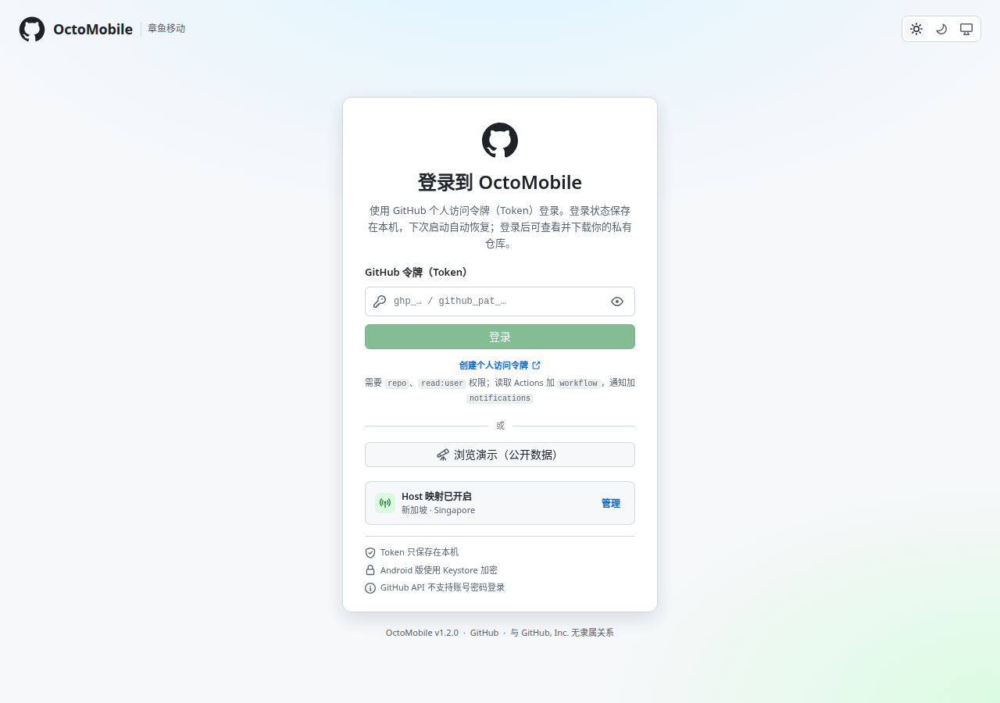
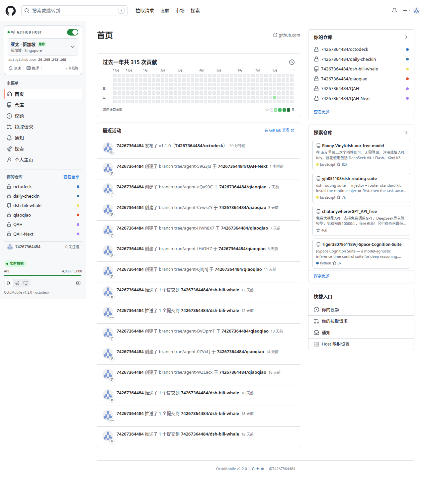
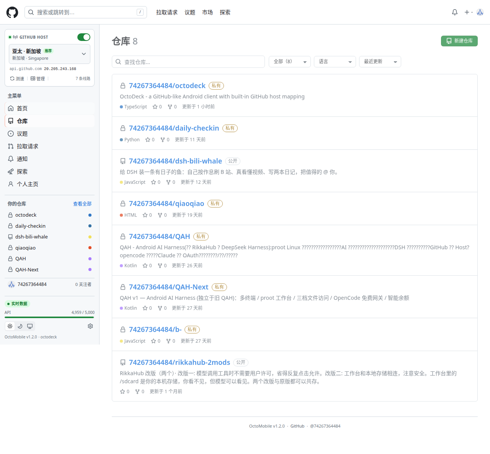
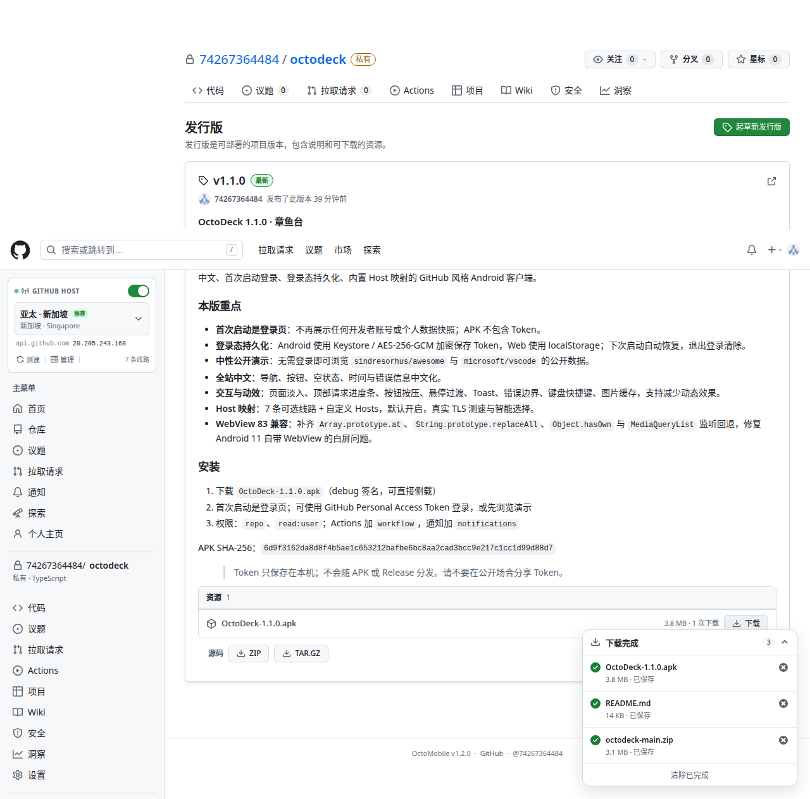
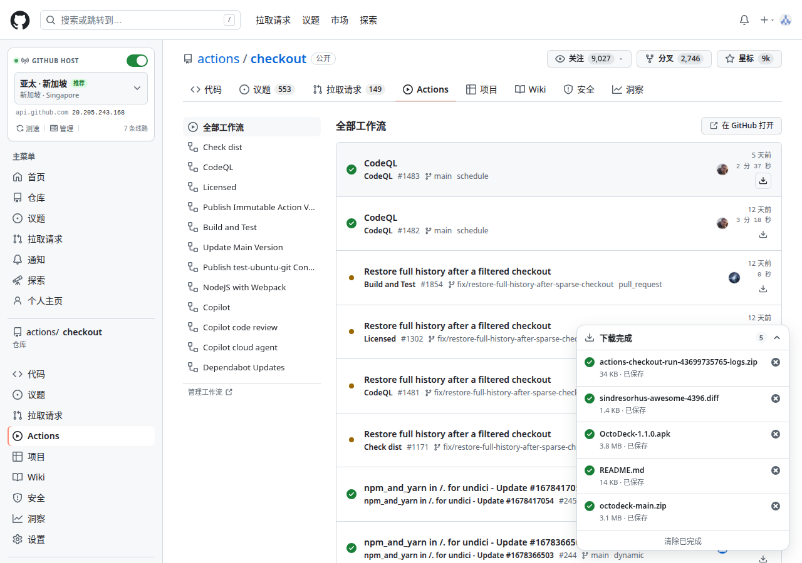
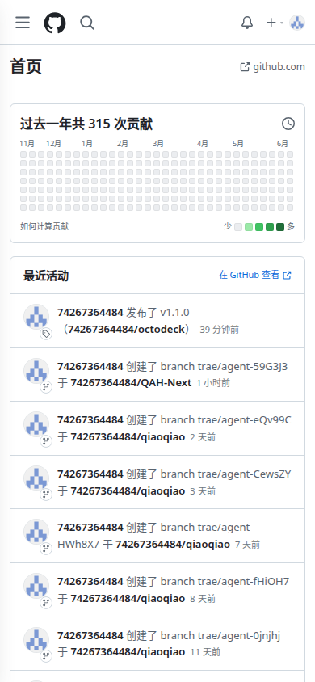
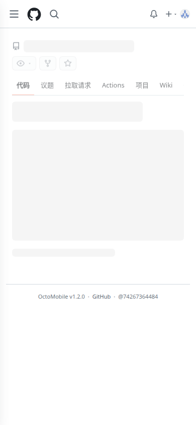
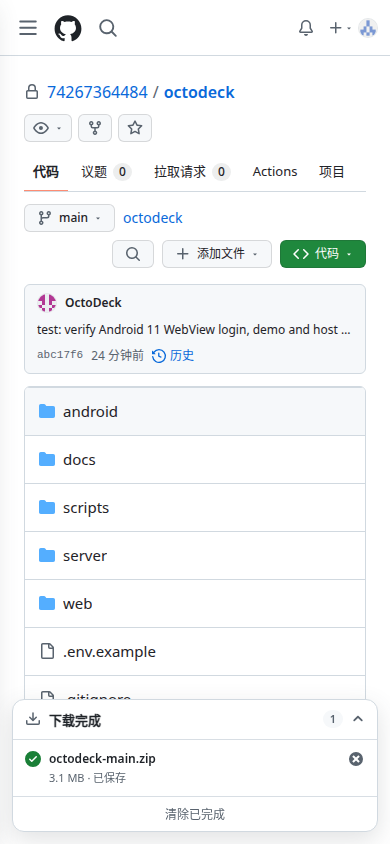

# OctoMobile · 章鱼移动

> 按 GitHub 网页视觉与信息架构重写的 Android 客户端。中文界面、真实 GitHub API、首次启动 Token 登录并持久保存登录态；左侧导航置顶内置 **Host 映射**，默认开启。
>
> 独立第三方项目，与 GitHub, Inc. 无隶属关系。GitHub、Octocat 是其商标。

   

## 截图

| 首次启动 · 登录（桌面） | 登录后首页（桌面） |
|---|---|
|  |  |
| **全部仓库 · 私有仓库可见** | **发行版 · 源码与附件下载** |
|  |  |
| **桌面下载托盘** | **手机端首页** |
|  |  |
| **手机端仓库页** | **手机端下载托盘** |
|  |  |

---

## 下载

- 最新 APK：本仓库 **Releases** 页面的 `OctoMobile-1.2.0.apk`
- 大小：约 4.0 MB（4,182,899 字节），debug 签名，可直接侧载
- SHA-256：`9a1c276ad76c75a685252d5044e36ef256157dc8a2d744f3cede94c684ef29f8`

---

## v1.2.0 更新

- **私有仓库修复**：仓库查询改为 `visibility=all&affiliation=owner,collaborator,organization_member`，登录后可看到自己拥有、协作和所属组织的私有仓库；仓库页支持「全部 / 公开 / 私有 / 已归档」筛选，私有仓库带锁图标与「私有」徽标。登录页明确提示「登录后可查看并下载你的私有仓库」。
- **全新品牌与图标**：软件名 **OctoMobile**（中文「章鱼移动」），图标为白色 GitHub 圆盘 + 蓝绿渐变手机，适配 Android 自适应图标与启动页；favicon 同步更新。
- **真实下载（不是外链）**：新增统一下载中心与下载托盘，覆盖仓库源码、单文件、Release 附件、PR Diff/Patch、Actions 运行日志；Web 端由本地服务流式下载，Android 端由 OkHttp 真实写入系统「下载/OctoMobile」。
- **手机化改造**：移除 `gh repo clone` 等命令行式入口；仓库代码页保留 HTTPS/SSH 地址复制，并可直接下载 ZIP / TAR.GZ；文件页「下载文件」、发行版「下载」、PR「下载 Diff」、Actions 每条运行记录「下载日志」都是一键操作。

## 它是什么

OctoMobile 不是 GitHub 的封装壳，而是一套按 GitHub 视觉与信息架构重写的 React 前端，加上 Android WebView 原生壳：

- **首次启动是登录页，不是别人的账号页**：干净的 GitHub 风格登录卡片，使用 Personal Access Token 登录。APK 不内置任何账号快照、不展示开发者账号、不包含真实 Token。
- **登录态持久化**：Android 版用 Android Keystore / AES-256-GCM 加密保存 Token，Web 版保存在 localStorage；下次启动自动恢复并拉取 `/user`。
- **中文界面**：导航、按钮、空状态、提示、相对时间、日期与错误信息均为中文；仓库名、Issue 标题、README 等 GitHub 内容保持原样。
- **中性演示数据**：登录页可以「浏览演示」，加载公开的 `sindresorhus/awesome` 与 `microsoft/vscode` 数据，无需 Token；演示不会使用你的账号，也不包含任何私有数据。
- **与 GitHub 网页同构的布局**：64px 顶栏、仓库二级导航、代码文件表、README、About 侧栏、Issues / PR / Actions / Insights / Releases / Settings、个人主页贡献日历、通知、Explore、搜索。
- **左侧导航置顶 Host 映射**：开关默认开启；内置官方直连、新加坡、日本、迪拜、弗吉尼亚、西雅图与自定义 Hosts。可查看每条线路的域名 → IP 明细，真实 TLS 测速，智能选择最快线路，复制 hosts 片段。
- **Android 原生 DNS 覆盖**：原生版用 OkHttp 自定义 `Dns`，把 `github.com`、`api.github.com`、`raw.githubusercontent.com`、`github.githubassets.com`、`codeload.github.com` 解析到所选 IP；TLS 仍使用真实域名做 SNI/证书校验。API、README 图片、头像、下载全部生效。
- **动效与交互**：路由淡入过渡、顶部请求进度条、按钮按压反馈、悬停过渡、骨架屏、Toast、Host 弹窗、移动端抽屉、下载进度动画、减少动态效果偏好支持、错误边界、图片内存缓存。
- **响应式**：桌面 1280px 与手机 390px 均验证；无横向溢出；移动端左侧栏变为抽屉，Host 卡片仍在抽屉最上方，下载托盘自动变为底部通栏。

## 真实下载

| 内容 | 入口 | API |
|---|---|---|
| 仓库源码 ZIP | 仓库代码页「代码」菜单 | `GET /repos/{owner}/{repo}/zipball/{ref}` |
| 仓库源码 TAR.GZ | 仓库代码页「代码」菜单 | `GET /repos/{owner}/{repo}/tarball/{ref}` |
| 单个文件（含二进制） | 文件页「下载文件」 | `GET /repos/{owner}/{repo}/contents/{path}?ref=` + raw Accept |
| Release 附件 | 发行版每个资源「下载」 | `GET /repos/{owner}/{repo}/releases/assets/{id}` |
| 发行版源码 | 发行版「源码 ZIP / TAR.GZ」 | zipball / tarball，`ref` 为 tag |
| PR 补丁 | PR 操作菜单 / 文件变更页 | `Accept: application/vnd.github.v3.diff` / `.patch` |
| Actions 运行日志 | 每条运行记录右侧下载按钮 | `GET /repos/{owner}/{repo}/actions/runs/{id}/logs` |

- **Web 端**：浏览器请求本地 Node 服务 `/api/download`，服务端带 Token、按当前 Host 映射连接 GitHub，跟随最多 6 次重定向，流式回传并设置 `Content-Disposition`；前端边接收边显示进度，完成后保存。
- **Android 端**：JS 调用原生桥 `startDownload`，OkHttp 使用自定义 DNS、自动携带 Keystore 中的 Token，跟随 GitHub → codeload → objects.githubusercontent.com 等重定向，写入 MediaStore（`Downloads/OctoMobile/`）。下载进度通过 `window.__octoDownloadProgress` 回传，托盘实时更新。
- 下载域名白名单、文件名清洗、重定向域名校验均已实现；私有仓库下载同样可用。

## Host 映射线路

默认开启，默认线路为 **亚太 · 新加坡**。IP 均为 GitHub 公开边缘节点，构建时逐条做过 TLS 证书校验。

| 线路 | github.com | api.github.com | 说明 |
|---|---|---|---|
| 官方直连 | 系统 DNS | 系统 DNS | 不覆盖解析 |
| 亚太 · 新加坡 | 20.205.243.166 | 20.205.243.168 | 默认，推荐 |
| 亚太 · 日本 | 20.27.177.113 | 20.27.177.116 | 东京边缘 |
| 中东 · 迪拜 | 20.233.83.145 | 20.233.83.146 | 备用 |
| 北美 · 弗吉尼亚 | 140.82.112.3 | 140.82.112.6 | GitHub AS36459 |
| 北美 · 西雅图 | 140.82.116.3 | 140.82.116.6 | 西海岸 |
| 自定义 Hosts | 手填 IPv4 | 手填 IPv4 | 留空走系统 DNS |

另外统一覆盖 `raw.githubusercontent.com`（185.199.108–111.133）、`github.githubassets.com`（185.199.108–111.154）、`codeload.github.com`（140.82.112.9）。

- **Android 原生版**：直接对设备网络生效，测速也是设备 → 边缘 IP 的真实握手。
- **浏览器预览版**：由本地 Node 服务代理请求；`测速` 会经出口代理 CONNECT 到所选 IP 并完成 TLS 校验。
- 映射只影响 OctoMobile 自身请求，**不修改系统 hosts，不需要 Root**。
- 可一键复制 `/etc/hosts` 片段给桌面使用。

## 页面

| 页面 | 状态 |
|---|---|
| 登录 / 登录态恢复 | Token 登录、Keystore/localStorage 持久化、失效自动回登录页 |
| 中性演示 | `sindresorhus/awesome` + `microsoft/vscode` 公开数据，无需登录 |
| Home / 活动流 / 贡献日历 | 实时 API 或中性演示 |
| 仓库代码 / 分支 / 目录 / 文件 / README | 完整，含语法高亮、文件下载、源码打包下载、文件最近提交 |
| Issues 列表 / 详情 / 时间线 / 评论 | 列表筛选/搜索；评论可发布（需 Token） |
| Pull requests 列表 / 会话 / Commits / Files changed | 真实 diff、行号、增删配色；Diff/Patch 下载 |
| Actions | workflow 列表、run 列表、运行日志下载、空状态 starter workflows |
| Insights / Security / Projects / Wiki / Discussions | Community 检查清单、语言、贡献者；只读项明确跳 GitHub |
| Releases | 真实 release、附件与源码下载 |
| Settings | 只读仓库设置预览 + 危险区跳 GitHub |
| Profile | 贡献日历、活动、热门仓库、Repositories / Stars |
| Notifications / Explore / Search | 真实 API，空状态与搜索分页 |
| App Settings | 登录、Host 映射、主题、数据缓存、关于 |

## 目录

```
octomobile/
├── web/                 React 18 + TypeScript + Vite
│   ├── src/components/  Header / LeftRail / HostCard / DownloadTray / Markdown / DiffView ...
│   ├── src/pages/       登录、首页、仓库、Issues、PR、Actions、Profile、Settings ...
│   ├── src/lib/         API 桥、Host 配置、下载中心、演示数据、路由、高亮
│   ├── src/data/        hosts.json（同时复制给 Android）
│   └── public/          demo.json、favicon、应用图标
├── server/              Node API 代理、Host 测速、图片代理、流式下载、静态服务
├── android/             Kotlin WebView 壳 + OkHttp DNS + Keystore + MediaStore 下载
│   └── app/src/main/java/com/octodeck/app/
├── scripts/             fetch-demo.mjs / build-apk.sh / qa-v11.cjs
└── docs/screenshots/    桌面与移动端验证截图
```

> Android 包名仍为 `com.octodeck.app`，WebView 桥接名仍为 `window.OctoDeck`，localStorage 键仍为 `octodeck.token`：这些是内部标识，改名会破坏已安装用户的登录态与桥接调用，因此保留。

## 运行 Web

```bash
cd web && npm install
cd ../server && npm install
cd ..
cp .env.example .env.local          # 可留空；留空时网页显示登录页
node server/index.mjs                # http://127.0.0.1:8787
```

`.env.local` 里填了 `GITHUB_TOKEN` 时，Web 预览由服务端自动登录（仅限本机调试）；留空则与 APK 一样从登录页开始。**不要把带 Token 的 server 暴露到公网。**

开发模式（Vite 热更新，`/api` 代理到 8787）：

```bash
node server/index.mjs
cd web && npm run dev                # http://127.0.0.1:5173
```

未登录状态预览（登录页 + 中性演示，不自动使用服务端 Token）：

```bash
OCTODECK_NO_SERVER_TOKEN=1 PORT=8788 node server/index.mjs
```

## 构建 APK

环境：JDK 17、Android SDK 35、Gradle 8.11.1。脚本会自动把 `web/dist` 与 `hosts.json` 打进 assets。

```bash
./scripts/build-apk.sh
# 产物：OctoMobile-1.2.0.apk（debug 签名，可直接侧载）
```

如果 JDK / SDK 不在默认路径：

```bash
OCTODECK_JAVA_HOME=/path/to/jdk17 ANDROID_HOME=/path/to/android-sdk ./scripts/build-apk.sh
```

脚本会先跑 JVM 单元测试（Host 解析、IPv4 校验、状态 JSON 解析），再构建 debug APK。**构建前会检查 assets 中是否出现真实 Token，发现则拒绝构建。**

### 登录与令牌

- 首次启动是登录页；使用 GitHub Personal Access Token 登录，不需要账号密码（GitHub API 不支持密码登录）。
- Android：Token 使用 Android Keystore / AES-256-GCM 加密保存；Web：localStorage。下次启动自动恢复登录态。
- 退出登录会清除本机 Token 并回到登录页；APK 与仓库中不包含任何令牌。
- 需要 `repo`、`read:user`；读 Actions 加 `workflow`；通知加 `notifications`。
- 你曾在对话中贴出的 Token 已经暴露，建议立即在 GitHub 撤销并重新生成；不要把它写进源码或 Release。

## 验证记录

### 浏览器端（Playwright + Chromium）

- 桌面 1280 × 900、手机 390 × 844；登录页、首页、仓库页、发行版、下载托盘均截图留档。
- **私有仓库**：使用真实 Token 登录后，`/repos` 共 8 个仓库，其中 **6 个带「私有」徽标**；左侧栏与首页仓库列表显示锁图标。
- **真实下载**（实际保存到磁盘并校验文件头）：
  - 私有仓库 ZIP：`octodeck-main.zip`，3,270,088 字节，`504b0304`（ZIP）；
  - 单文件：`README.md`，14,811 字节；
  - 私有 Release 附件：`OctoDeck-1.1.0.apk`，4,032,739 字节，识别为 Android APK；
  - PR Diff：`sindresorhus-awesome-4396.diff`，1,432 字节，首行 `diff --git`；
  - Actions 日志：`actions-checkout-run-43699735765-logs.zip`，34,877 字节，可正常解压；
  - 手机端（390 × 844）同样完成 ZIP 下载与托盘展示。
- 所有页面 `scrollWidth - innerWidth = 0`，无横向溢出。

### Android

- `:app:testDebugUnitTest`：7 个 JVM 测试全部通过（Host 映射解析、禁用回退、官方直连、自定义合法/非法 IP、状态 JSON 解析与损坏回退）。
- 新增原生下载桥：`startDownload(id, url, filename, accept)`，OkHttp 自定义 DNS + Authorization + 重定向，MediaStore 写入 `Downloads/OctoMobile/`；进度回调到 Web 下载托盘。
- 模拟器无 KVM，只能 TCG 软件模拟，系统 UI 会 ANR；完整点击流以浏览器端与真机为准。

## 已知限制

- **模拟器**：沙箱无 KVM，只能强制 TCG 软件模拟；系统 UI 会 ANR，完整点击流没有在模拟器里跑完。
- **旧 WebView**：Android 11 自带 WebView 83 不支持 flex gap，间距更紧凑；现代 WebView 正常。
- 仓库 Settings 是只读预览；合并 PR、创建 Release、修改仓库设置会跳转 GitHub。
- 部分 GitHub 能力依赖 Token 权限；没有 Token 时只能使用中性演示，不会展示任何个人数据。
- Actions 日志可能因 GitHub 保留期限过期而返回 404；下载托盘会显示具体错误。
- Host IP 会随 GitHub 调度变化；连接失败时请测速或切回官方直连。
- Web 预览版的 Host 映射由服务端代理执行；在本沙箱中出口代理会解析域名，因此「测速」通过 CONNECT 到边缘 IP 验证 TLS，但 API 流量本身走代理。Android 原生版没有这个限制。
- 未做 iOS / 桌面打包；Web 版可直接部署。

## 安全

- 不要把 `.env.local`、`local.properties`、`*.jks` 提交到 Git；这些已在 `.gitignore`。
- 本地 Node 服务绑定 `127.0.0.1`，并且 `.env.local` 里可能保存真实 Token。**不要把带 Token 的 server 直接暴露到公网。**
- `/api/download` 有域名白名单与重定向校验，只允许 GitHub 及其 CDN；文件名会清洗，避免路径穿越。
- 原生 WebView 只加载 `appassets.androidplatform.net` 下的本地资源；所有外部链接交给系统浏览器，桥接 API 不暴露给远程页面。
- 图片代理/加载有域名白名单，避免把 Token 或本地网络暴露给任意 README 图片地址。
- `allowBackup=false`，系统备份不会带走加密令牌。
- 仓库历史已重写为不含个人截图/快照的版本；旧 Release 已删除。

## 许可

OctoMobile 代码采用 MIT。GitHub Octicons 使用 MIT；GitHub 名称与 Octocat 图形是 GitHub, Inc. 的商标，本项目仅作兼容性展示。
