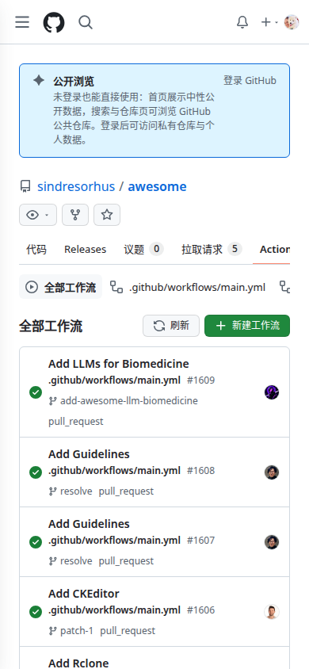
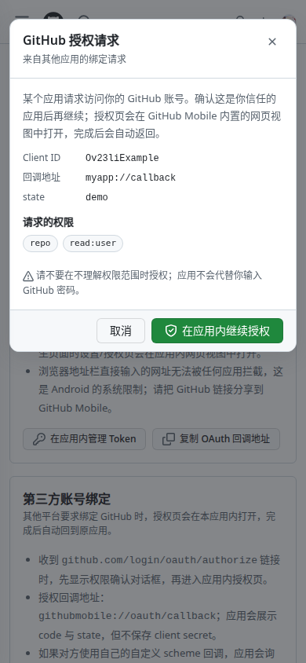
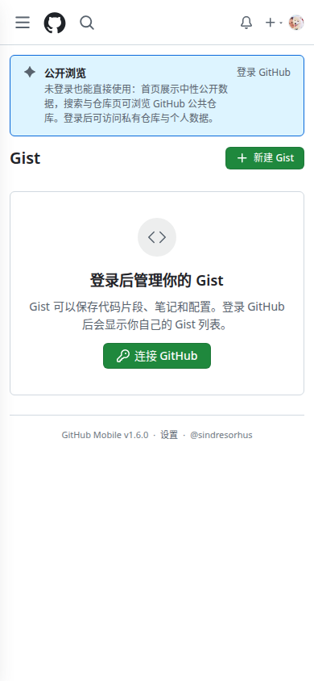
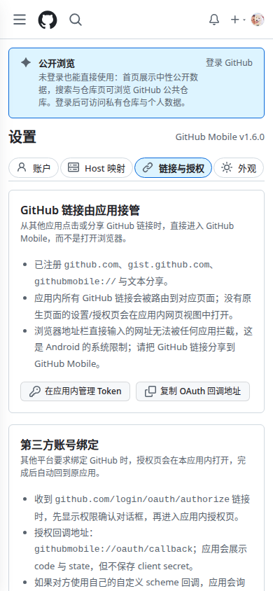
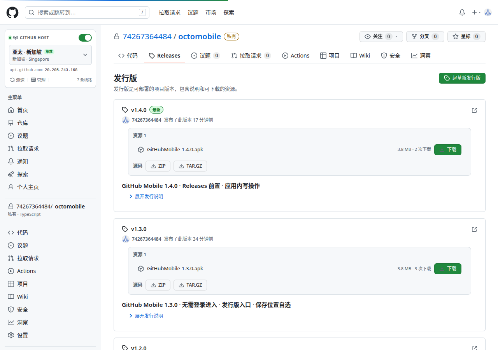

# GitHub Mobile

**一款按 GitHub 网页的视觉与信息架构重写的 Android 客户端。** 公开内容无需登录即可浏览；登录后可查看私有仓库、处理通知、管理议题与 PR、运行 Actions、发布 Release。中文界面，直接调用真实 GitHub API，内置 Host 映射以改善网络连通性。

> 本项目为独立第三方客户端，与 GitHub, Inc. 无隶属关系。GitHub、Octocat 为其商标，项目名称仅用于说明兼容目标，不代表官方应用。

    

## 功能亮点

- **无需登录即可浏览**：启动直接进入公开内容，仓库、代码、Issues、Pull Requests、Actions、Releases、用户主页、搜索全部可用。
- **完整的仓库操作**（登录后）：新建仓库，创建、编辑、上传、删除文件，新建议题与 PR，合并 PR，发布 Release，修改仓库设置、可见性与归档状态。
- **Actions 全流程**：从模板新建工作流、查看运行详情与每一步状态、重新运行、取消运行、下载日志。
- **Releases 优先展示**：下载区置于发行说明之前，资源与源码包一键下载，下载位置可记忆、随时更换。
- **Insights、Community、Wiki、Discussions、Projects、Security**：常用仓库子页面均在应用内呈现，自动补齐 README、LICENSE、贡献指南等社区标准文件。
- **GitHub 深链接管**：在其他应用中打开 `github.com` / `gist.github.com` 链接可直接进入对应页面，也可从浏览器通过分享发送到本应用。
- **第三方 OAuth 授权**：为其他平台绑定 GitHub 账号时，授权页在应用内打开，回调结果可复制或交回原应用，不保存任何 `client_secret`。
- **真实下载**：源码 ZIP/TAR.GZ、单个文件、Release 附件、PR diff/patch、Actions 日志均通过 GitHub API 实际传输。
- **后台下载不中断**：开始下载后可切到其他应用或锁屏，传输继续进行并在通知栏显示状态。

## 截图

| Actions · 模板与运行 | 深链与第三方授权 |
|---|---|
|  |  |
| **Gist · 应用内创建与查看** | **设置 · 链接与授权** |
|  |  |
| **Releases · 下载区置顶** | **Actions 运行详情** |
|  |  |

## 下载与安装

- 安装包：前往本仓库 [Releases](https://github.com/74267364484/GitHub-Mobile/releases) 下载 `GitHubMobile-1.6.1.apk`
- 系统要求：Android 8.0（API 26）及以上
- 大小：4,013,018 字节（约 3.8 MB）
- SHA-256：`dab458c82caf752d13ed38c30586dbce4e6bf9ea00d20e2cadf4ac91f7419d94`
- 安装包使用 debug 签名，允许「安装未知来源应用」后即可侧载；升级安装会保留已有登录状态与下载目录设置。

## 使用方式

1. 首次启动直接进入「公开浏览」，无需账号即可查看公开仓库与搜索。
2. 需要访问私有仓库、通知、个人主页或执行写操作时，进入「设置 → GitHub 连接」登录。
3. 登录使用 GitHub Personal Access Token，不接触账号密码。Token 保存在 Android Keystore（AES-256-GCM）中，退出登录即清除。
4. 建议为 Token 勾选以下权限：

| 权限 | 用途 |
|---|---|
| `repo` | 私有仓库读写、议题、PR、Release |
| `read:user` | 个人资料与贡献数据 |
| `workflow` | 读取与操作 Actions |
| `notifications` | 通知列表与已读状态 |
| `gist` | 创建与管理 Gist |

GitHub 匿名 API 限流约为 60 次/小时/IP；达到上限时应用会提示登录后继续，不会白屏。私有仓库必须登录，这是 GitHub 服务端的权限规则。

## Host 映射

左侧导航顶部内置 Host 映射，默认开启，默认线路为**亚太 · 新加坡**。映射只影响本应用自身的请求，不修改系统 hosts，也不需要 Root；可一键复制 `/etc/hosts` 片段供桌面端使用。

| 线路 | github.com | api.github.com | 说明 |
|---|---|---|---|
| 官方直连 | 系统 DNS | 系统 DNS | 不覆盖解析 |
| 亚太 · 新加坡 | 20.205.243.166 | 20.205.243.168 | 默认，推荐 |
| 亚太 · 日本 | 20.27.177.113 | 20.27.177.116 | 东京边缘 |
| 中东 · 迪拜 | 20.233.83.145 | 20.233.83.146 | 备用 |
| 北美 · 弗吉尼亚 | 140.82.112.3 | 140.82.112.6 | GitHub AS36459 |
| 北美 · 西雅图 | 140.82.116.3 | 140.82.116.6 | 西海岸 |
| 自定义 Hosts | 手填 IPv4 | 手填 IPv4 | 留空走系统 DNS |

同时统一覆盖 `raw.githubusercontent.com`（185.199.108–111.133）、`github.githubassets.com`（185.199.108–111.154）、`codeload.github.com`（140.82.112.9）。

Android 版通过 OkHttp 自定义 DNS 把上述域名解析到所选 IP，TLS 仍以真实域名做 SNI 与证书校验；内置测速为设备到边缘节点的真实 TLS 握手。GitHub 的 IP 会随调度变化，连接异常时测速或切回官方直连即可。

## 下载行为

| 内容 | 入口 |
|---|---|
| 仓库源码 ZIP / TAR.GZ | 代码页「代码」菜单 |
| 单个文件（含二进制） | 文件页「下载文件」 |
| Release 附件 | 发行版资源列表 |
| 发行版源码包 | 发行版「源码 ZIP / TAR.GZ」 |
| PR 补丁 | PR 操作菜单 / 文件变更页 |
| Actions 运行日志 | 每条运行记录右侧下载按钮 |

- 首次下载时通过系统文件夹选择器指定保存目录，授权会被持久保存；之后直接写入该目录，可在下载托盘或设置中随时更换。
- 文件名优先取自 `Content-Disposition`，缺失扩展名时按 Content-Type 补齐。
- 下载过程显示实时进度；离开应用或锁屏后继续传输，通知栏可见状态（Android 13+ 需授予通知权限才能看到通知）。
- 下载域名白名单、文件名清洗与重定向校验均已启用，私有仓库文件同样支持。

## 支持的页面

| 页面 | 说明 |
|---|---|
| 公开浏览 | 无需登录，内置公开示例数据 + 匿名 GitHub API |
| 登录与登录态恢复 | 按需登录，Keystore 持久化，失效自动回到公开浏览 |
| 首页 / 活动流 / 贡献日历 | 公开数据或实时 API |
| 仓库代码 / 分支 / 目录 / 文件 / README | 语法高亮、文件下载、源码打包 |
| Releases | 应用内发布、编辑、资源与源码下载 |
| Issues | 列表筛选与搜索、详情、时间线、评论、标签、负责人、里程碑 |
| Pull Requests | 会话、Commits、Files changed、真实 diff、合并/关闭、Diff/Patch 下载 |
| Actions | 工作流列表、运行详情、重跑/取消、日志下载 |
| Projects | GraphQL 读取 Projects v2，应用内新建 |
| Wiki | 读取并渲染 Wiki 首页 |
| Discussions | 列表、页内展开、应用内发起讨论 |
| Security | Dependabot 与代码扫描警报、SECURITY.md 检测 |
| Insights | Community 检查清单、语言、贡献者、提交活动 |
| Settings | 仓库设置应用内编辑：名称、描述、话题、功能开关、可见性、归档、删除 |
| Profile | 贡献日历、活动、热门仓库、Repositories / Stars、关注列表 |
| Notifications / Explore / Search | 真实 API，支持分页与空状态 |
| Gist | 列表、详情、创建公开或私密 Gist |
| App Settings | 登录、Host 映射、主题、缓存、链接与授权 |

仓库的高级管理项（访问控制、Webhooks、Pages、仓库转移等）通过应用内 GitHub 网页视图打开，不会跳出应用。该视图仅允许 GitHub 域名，且不暴露 JS 桥接。

## 项目结构

```
GitHub-Mobile/
├── web/                 React 18 + TypeScript + Vite 前端
│   ├── src/components/  Header / LeftRail / HostCard / DownloadTray / Markdown / DiffView ...
│   ├── src/pages/       首页、仓库、Releases、Issues、PR、Actions、Profile、Settings ...
│   ├── src/lib/         API 桥、Host 配置、下载中心、公开浏览回退、路由、高亮
│   ├── src/data/        hosts.json（构建时同步给 Android）
│   └── public/          demo.json、favicon、应用图标
├── server/              Node API 代理、Host 测速、图片代理、流式下载、静态服务
├── android/             Kotlin WebView 壳 + OkHttp 自定义 DNS + Keystore + SAF 下载
│   └── app/src/main/java/com/octodeck/app/
├── scripts/             获取演示数据、构建 APK、QA 脚本
└── docs/screenshots/    界面截图
```

## 本地运行

### Web 预览

```bash
cd web && npm install
cd ../server && npm install
cd ..
cp .env.example .env.local          # 可留空，留空时直接进入公开浏览
node server/index.mjs                # http://127.0.0.1:8787
```

开发模式（Vite 热更新，`/api` 自动代理到 8787）：

```bash
node server/index.mjs
cd web && npm run dev                # http://127.0.0.1:5173
```

服务端默认不会使用 `.env.local` 中的 Token 自动登录。仅在本地调试且明确需要服务端令牌时启用：

```bash
OCTODECK_ALLOW_SERVER_TOKEN=1 node server/index.mjs
```

> 带 Token 的服务端不要暴露到公网。

### 构建 APK

环境要求：JDK 17、Android SDK 35、Gradle 8.11。构建脚本会自动打包 `web/dist` 与 `hosts.json` 到 assets，并在打包前检查是否混入真实 Token。

```bash
./scripts/build-apk.sh
# 产物：GitHubMobile-1.6.1.apk（debug 签名，可直接安装）
```

JDK / SDK 不在默认路径时：

```bash
OCTODECK_JAVA_HOME=/path/to/jdk17 ANDROID_HOME=/path/to/android-sdk ./scripts/build-apk.sh
```

脚本会先运行 JVM 单元测试（Host 映射解析、IPv4 校验、状态 JSON 解析），再构建 debug APK。

## 隐私与安全

- Token 仅保存在本机：Android 使用 Keystore + AES-256-GCM 加密，Web 版使用 localStorage；APK 与仓库中不包含任何令牌。
- 原生 WebView 只加载本地 assets，外部链接交给系统浏览器或受限网页视图；JS 桥接不暴露给远程页面。
- `/api/download` 仅允许 GitHub 及其 CDN 域名，跟随重定向时逐跳校验，文件名会清洗以避免路径穿越。
- 图片加载有域名白名单，避免 Token 或内网地址经由任意图片请求泄露。
- `allowBackup=false`，系统备份不会带走加密后的令牌。
- `.env.local`、`local.properties`、`*.jks` 已在 `.gitignore` 中；请勿将真实 Token 写入源码、Issue 或 Release。

## 已知限制

- **匿名限流**：未登录时使用 GitHub 匿名 API，约 60 次/小时/IP；超限会提示登录。
- **旧版 WebView**：Android 11 自带的 WebView 83 不支持 flex gap，间距会略紧凑；更新 WebView 后正常。
- **浏览器深链**：在浏览器地址栏直接输入网址无法被第三方应用拦截，这是 Android 的系统限制；可将链接分享到本应用，或在系统设置中将 GitHub 链接的默认打开方式设为 GitHub Mobile。
- **高级仓库设置**：访问控制、Webhooks、Pages 等仍通过应用内 GitHub 网页视图完成。
- **Actions 日志**：超过 GitHub 保留期限后接口返回 404，下载托盘会显示具体原因。
- **Host IP**：GitHub 边缘节点会变化，连接失败时测速或切回官方直连。
- 暂无 iOS 与桌面客户端；Web 前端可独立部署。

## 参与贡献

欢迎提交 Issue 与 Pull Request。建议先开 Issue 描述问题或需求，说明复现步骤、Android 版本与设备型号；提交代码前请确保 `./scripts/build-apk.sh` 与 JVM 单元测试通过。请勿在 Issue、日志或截图中包含 Token、Cookie 等凭据。

## 更新日志

各版本的变更记录见 [CHANGELOG.md](CHANGELOG.md) 与 [Releases](https://github.com/74267364484/GitHub-Mobile/releases)。

## 许可证

本项目代码采用 MIT 许可证。GitHub Octicons 使用 MIT 许可证。GitHub 名称与 Octocat 图形是 GitHub, Inc. 的商标；本项目为非官方第三方客户端，仅作兼容性展示。
