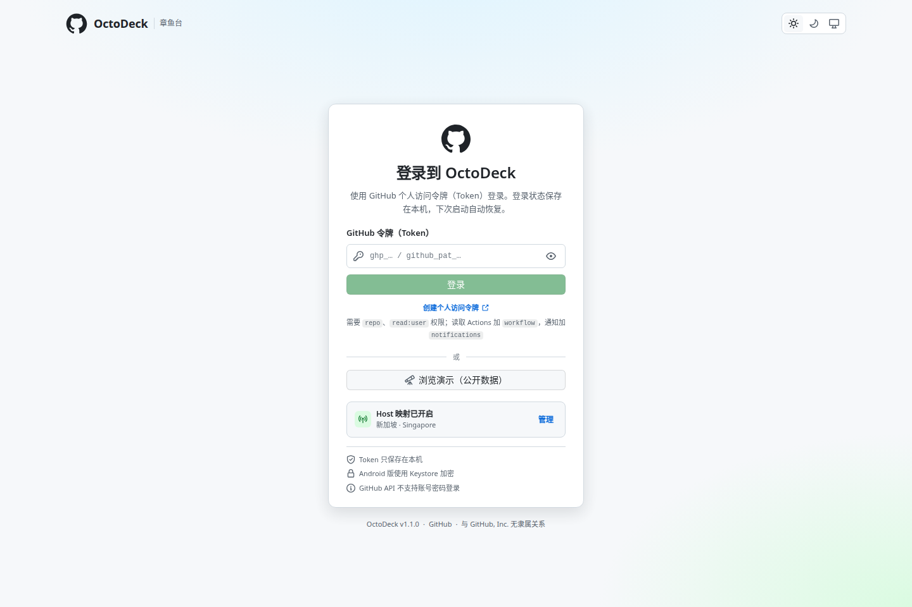
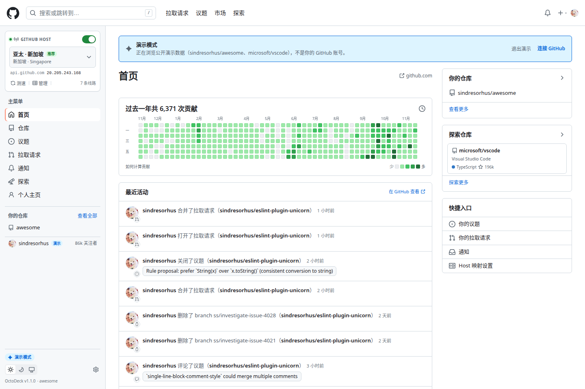
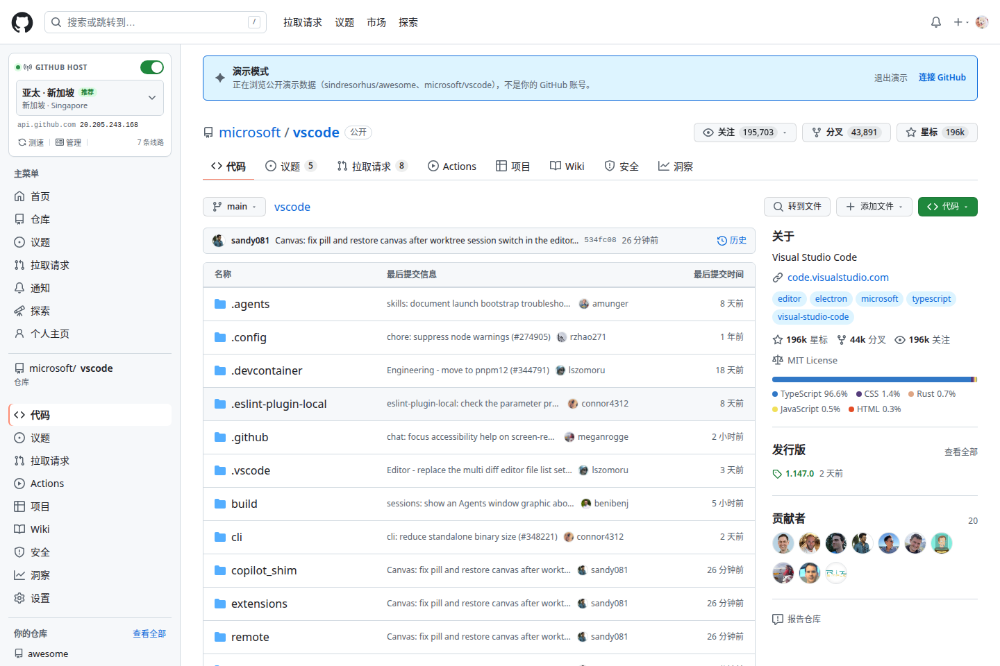
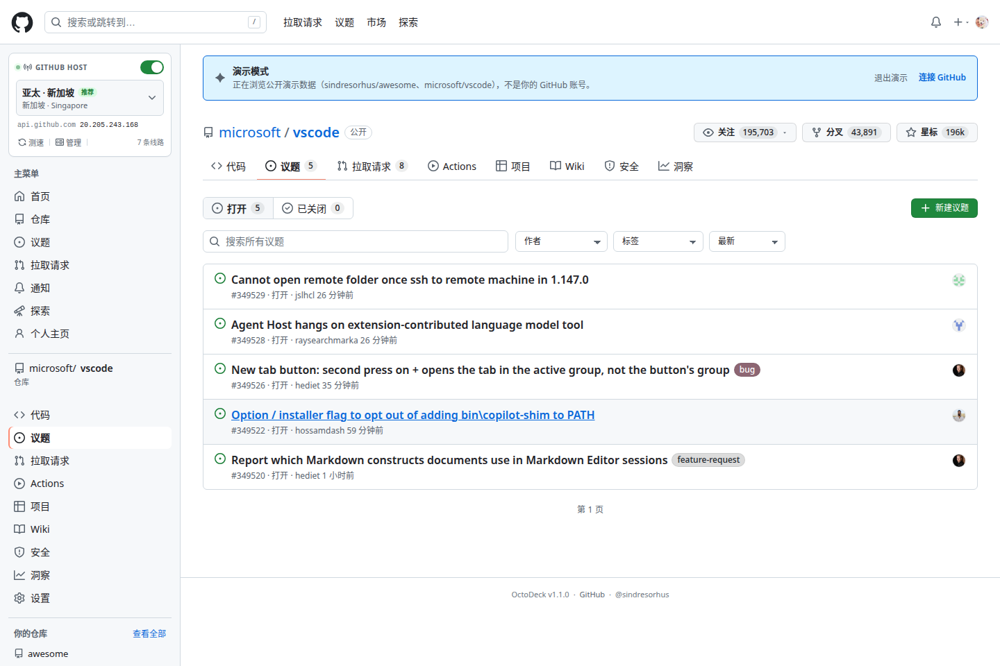
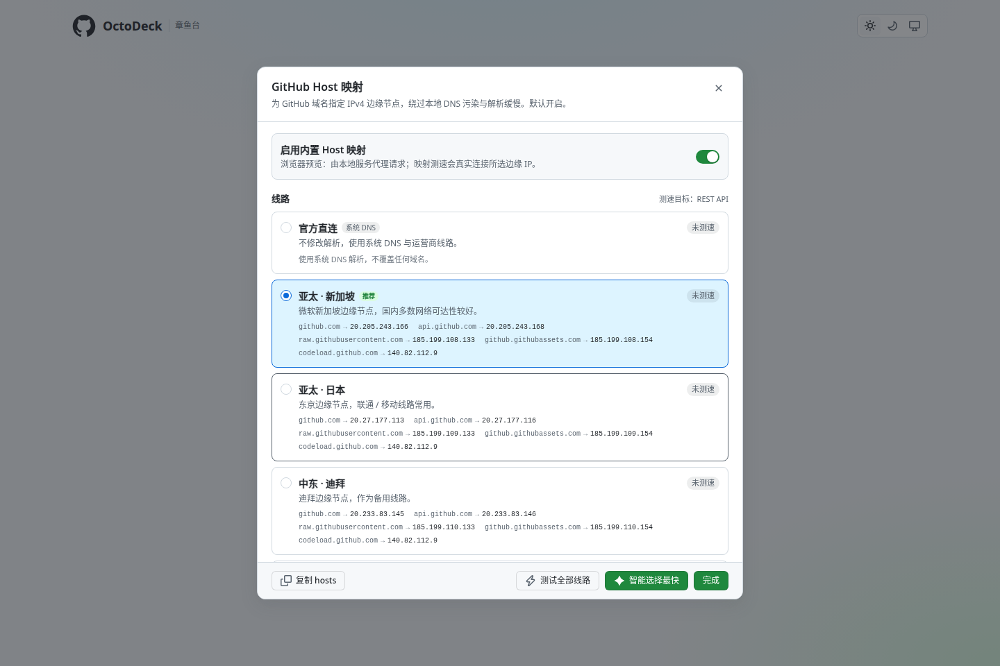
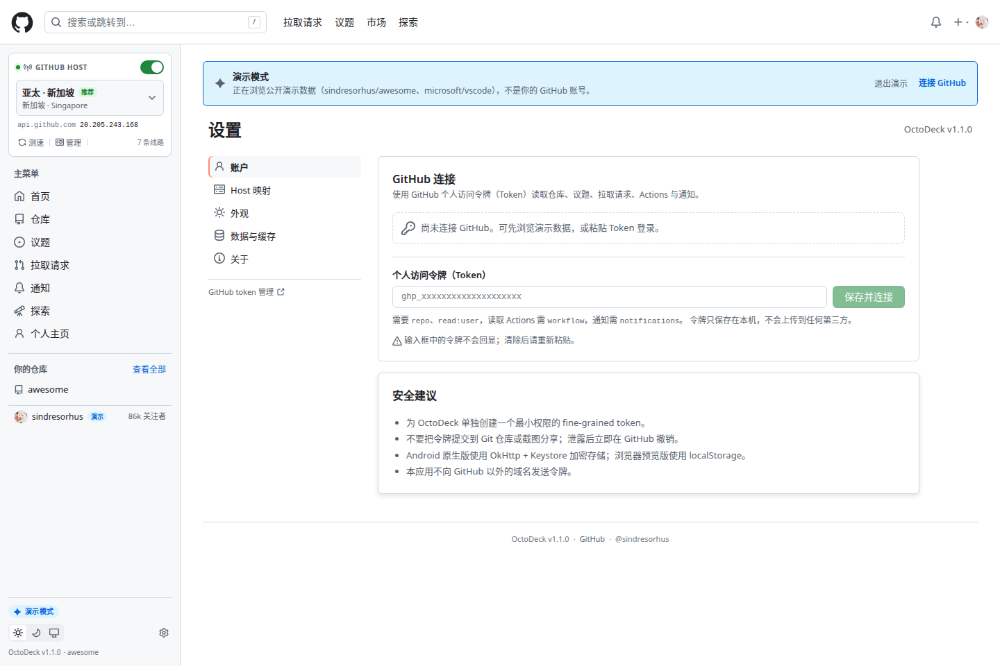
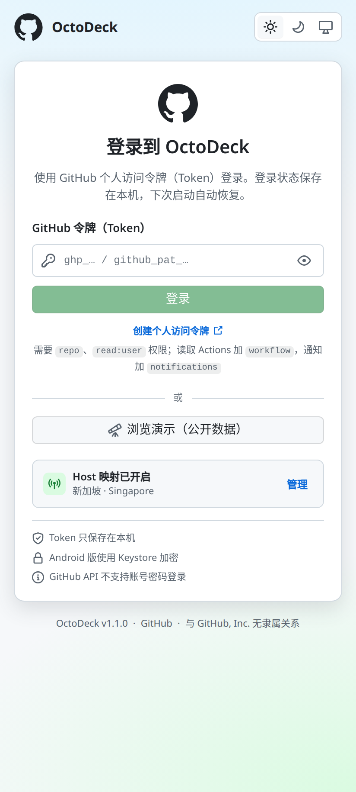
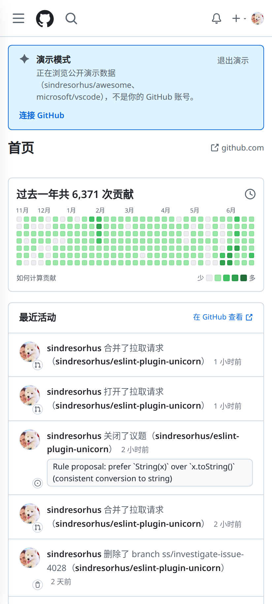
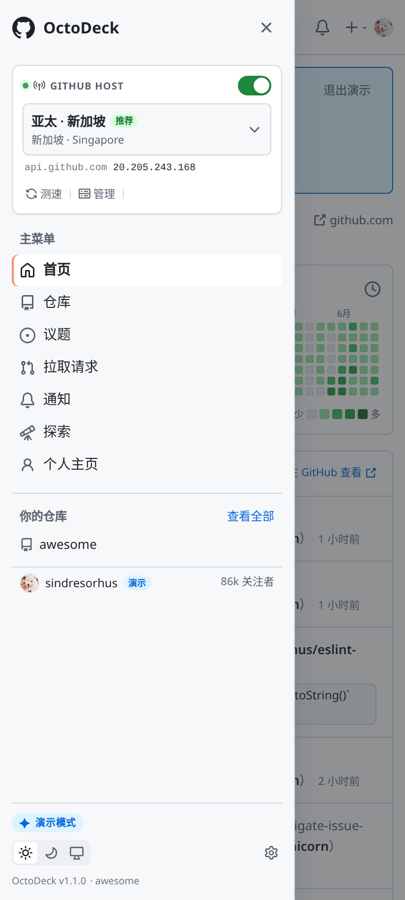
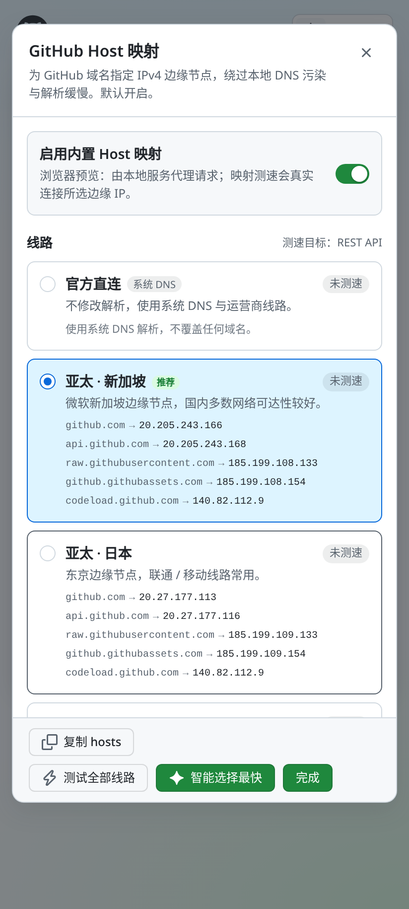

# OctoDeck · 章鱼台

> 一个按 GitHub 网页视觉与信息架构重写的 Android 客户端。中文界面、真实 GitHub API、首次启动 Token 登录并持久保存登录态；左侧导航栏置顶内置 **Host 映射**，默认开启。

> 独立第三方项目，与 GitHub, Inc. 无隶属关系。GitHub、Octocat 是其商标。

   

## 截图

| 首次启动 · 登录（桌面） | 演示首页（桌面） |
|---|---|
|  |  |
| **仓库代码（中文）** | **议题列表** |
|  |  |
| **Host 映射（置顶，默认开启）** | **设置 · 数据与缓存** |
|  |  |
| **手机登录页** | **手机演示首页** |
|  |  |
| **手机抽屉（Host 卡片在置顶）** | **手机 Host 弹窗** |
|  |  |

---

## 下载

- 最新 APK：本仓库 **Releases** 页面的 `OctoDeck-1.1.0.apk`
- 本地文件：`/workspace/octodeck/OctoDeck-1.1.0.apk`
- SHA-256：`6d9f3162da8d8f4b5ae1c653212bafbe6bc8aa2cad3bcc9e217c1cc1d99d88d7`
- 大小：约 3.9 MB，debug 签名，可直接侧载

---

## 它是什么

OctoDeck 不是 GitHub 的封装壳，而是一套按 GitHub 视觉与信息架构重写的 React 前端，加上 Android WebView 原生壳：

- **首次启动是登录页，不是别人的账号页**：干净的 GitHub 风格登录卡片，使用 Personal Access Token 登录。APK 不内置任何账号快照、不展示开发者账号、不包含真实 Token。
- **登录态持久化**：Android 版用 Android Keystore / AES-256-GCM 加密保存 Token，Web 版保存在 localStorage；下次启动自动恢复并拉取 `/user`，无需重复输入。退出登录会清除本地凭证并回到登录页。
- **中文界面**：导航、按钮、空状态、提示、相对时间、日期与错误信息均为中文；仓库名、Issue 标题、README 等 GitHub 内容保持原样。
- **中性演示数据**：登录页可以「浏览演示」，加载公开的 `sindresorhus/awesome` 与 `microsoft/vscode` 数据，展示代码、README、Issues、PR、Actions、贡献日历等完整界面；演示不会使用你的账号，也不包含任何私有数据。
- **与 GitHub 网页同构的布局**：64px 顶栏、仓库二级导航、代码文件表、README、About 侧栏、Issues / PR / Actions / Insights / Releases / Settings、个人主页贡献日历、通知、Explore、搜索。
- **左侧导航置顶 Host 映射**：开关默认开启；内置官方直连、新加坡、日本、迪拜、弗吉尼亚、西雅图与自定义 Hosts。可查看每条线路的域名 → IP 明细，真实 TLS 测速，智能选择最快线路，复制 hosts 片段。
- **Android 原生 DNS 覆盖**：原生版用 OkHttp 自定义 `Dns`，把 `github.com`、`api.github.com`、`raw.githubusercontent.com`、`github.githubassets.com`、`codeload.github.com` 解析到所选 IP；TLS 仍使用真实域名做 SNI/证书校验。API、README 图片、头像全部生效。
- **动效与交互**：路由淡入过渡、顶部请求进度条、按钮按压反馈、悬停过渡、骨架屏、Toast、Host 弹窗、移动端抽屉、减少动态效果偏好支持、错误边界、图片内存缓存。
- **键盘操作**：`/` 聚焦搜索；`g h` 首页、`g i` 议题、`g p` 拉取请求、`g n` 通知、`g e` 探索、`g s` 设置；`Esc` 关闭弹窗/Toast。
- **响应式**：桌面 1440px 与 Pixel 412px 均验证；无横向溢出；移动端左侧栏变为抽屉，Host 卡片仍在抽屉最上方。

## Host 映射线路

默认开启，默认线路为 **亚太 · 新加坡**。IP 均为 GitHub 公开边缘节点，构建时逐条做过 TLS 证书校验（2026-11-21）。

| 线路 | github.com | api.github.com | 说明 |
|---|---|---|---|
| 官方直连 | 系统 DNS | 系统 DNS | 不覆盖解析 |
| 亚太 · 新加坡 | 20.205.243.166 | 20.205.243.168 | 默认，推荐 |
| 亚太 · 日本 | 20.27.177.113 | 20.27.177.116 | 东京边缘 |
| 中东 · 迪拜 | 20.233.83.145 | 20.233.83.146 | 备用 |
| 北美 · 弗吉尼亚 | 140.82.112.3 | 140.82.112.6 | GitHub AS36459 |
| 北美 · 西雅图 | 140.82.116.3 | 140.82.116.6 | 西海岸 |
| 自定义 Hosts | 手填 IPv4 | 手填 IPv4 | 留空走系统 DNS |

另外统一覆盖 `raw.githubusercontent.com`（185.199.108–111.133）、`github.githubassets.com`（185.199.108–111.154）、`codeload.github.com`（140.82.112.9）。

- **Android 原生版**：直接对设备网络生效，测速也是设备 → 边缘 IP 的真实握手。
- **浏览器预览版**：由本地 Node 服务代理请求；`测速` 会经出口代理 CONNECT 到所选 IP 并完成 TLS 校验。页面上会明确标注当前环境。
- 映射只影响 OctoDeck 自身请求，**不修改系统 hosts，不需要 Root**。
- 可一键复制 `/etc/hosts` 片段给桌面使用。

## 页面

| 页面 | 状态 |
|---|---|
| 登录 / 登录态恢复 | Token 登录、Keystore/localStorage 持久化、失效自动回登录页 |
| 中性演示 | `sindresorhus/awesome` + `microsoft/vscode` 公开数据，无需登录 |
| Home / 活动流 / 贡献日历 | 实时 API 或中性演示 |
| 仓库代码 / 分支 / 目录 / 文件 / README | 完整，含语法高亮、Raw、GitHub 跳转、文件最近提交 |
| Issues 列表 / 详情 / 时间线 / 评论 | 列表筛选/搜索；评论可发布（需 Token） |
| Pull requests 列表 / 会话 / Commits / Files changed | 真实 diff、行号、增删配色；合并跳 GitHub |
| Actions | workflow 列表、run 列表、空状态 starter workflows |
| Insights / Security / Projects / Wiki / Discussions | Community 检查清单、语言、贡献者；只读项明确跳 GitHub |
| Releases | 真实 release、assets 下载 |
| Settings | 只读仓库设置预览 + 危险区跳 GitHub |
| Profile | 贡献日历、活动、热门仓库、Repositories / Stars |
| Notifications / Explore / Search | 真实 API，空状态与搜索分页 |
| App Settings | 登录、Host 映射、主题、数据缓存、关于 |

## 目录

```
octodeck/
├── web/                 React 18 + TypeScript + Vite
│   ├── src/components/  Header / LeftRail / HostCard / Markdown / DiffView ...
│   ├── src/pages/       登录、首页、仓库、Issues、PR、Actions、Profile、Settings ...
│   ├── src/lib/         API 桥、Host 配置、演示数据、路由、高亮
│   ├── src/data/        hosts.json（同时复制给 Android）
│   └── public/          demo.json（中性公开演示数据）
├── server/              Node API 代理、Host 测速、图片代理、静态服务
├── android/             Kotlin WebView 壳 + OkHttp DNS + Keystore
│   └── app/src/main/java/com/octodeck/app/
├── scripts/             fetch-demo.mjs / build-apk.sh / qa-v11.cjs
└── docs/screenshots/    桌面与移动端验证截图
```

## 运行 Web

```bash
cd web && npm install
cd ../server && npm install
cd ..
cp .env.example .env.local          # 可留空；留空时网页显示登录页
node server/index.mjs                # http://127.0.0.1:8787
```

`.env.local` 里填了 `GITHUB_TOKEN` 时，Web 预览由服务端自动登录（仅限本机调试）；留空则与 APK 一样从登录页开始。**不要把带 Token 的 server 暴露到公网。**

开发模式（Vite 热更新，`/api` 代理到 8787）：

```bash
node server/index.mjs
cd web && npm run dev                # http://127.0.0.1:5173
```

未登录状态预览（登录页 + 中性演示，不自动使用服务端 Token）：

```bash
OCTODECK_SNAPSHOT_ONLY=1 PORT=8788 node server/index.mjs
```

## 构建 APK

环境：JDK 17、Android SDK 35、Gradle 8.11.1。脚本会自动把 `web/dist` 与 `hosts.json` 打进 assets。

```bash
./scripts/build-apk.sh
# 产物：OctoDeck-1.1.0.apk（约 3.9 MB，debug 签名，可直接侧载）
```

当前构建产物的 SHA-256：

```
6d9f3162da8d8f4b5ae1c653212bafbe6bc8aa2cad3bcc9e217c1cc1d99d88d7  OctoDeck-1.1.0.apk
```

> 若之后重新构建，请以 `sha256sum OctoDeck-1.1.0.apk` 的新结果为准。

如果 JDK / SDK 不在默认路径：

```bash
OCTODECK_JAVA_HOME=/path/to/jdk17 ANDROID_HOME=/path/to/android-sdk ./scripts/build-apk.sh
```

脚本会先跑 JVM 单元测试（Host 解析、IPv4 校验、状态 JSON 解析），再构建 debug APK（调试签名，可直接侧载）。**构建前会检查 assets 中是否出现真实 Token，发现则拒绝构建。**

### 登录与令牌

- 首次启动是登录页；使用 GitHub Personal Access Token 登录，不需要账号密码（GitHub API 不支持密码登录）。
- Android：Token 使用 Android Keystore / AES-256-GCM 加密保存；Web：localStorage。下次启动自动恢复登录态。
- 退出登录会清除本机 Token 并回到登录页；APK 与仓库中不包含任何令牌。
- 需要 `repo`、`read:user`；读 Actions 加 `workflow`；通知加 `notifications`。
- 你曾在对话中贴出的 Token 已经暴露，建议立即在 GitHub 撤销并重新生成；不要把它写进源码或 Release。

## 验证记录（本机沙箱）

### 浏览器端（Playwright + Chromium）

- 桌面 1440 × 960、移动 412 × 915（Pixel 7 UA / touch / DPR 2）。
- 首次启动登录页：无任何个人账号、私有仓库名或 Token 文本；登录卡片、Host 入口、演示入口正常。
- 点击「浏览演示」加载中性数据：贡献日历、活动流、仓库代码、文件最近提交、Issues 数量与列表、Host 弹窗、设置页均正常。
- 登录态：在无服务端 Token 的测试服务上输入 Token，登录成功；刷新页面后自动恢复登录，不再出现登录页。
- 所有页面 `scrollWidth - innerWidth = 0`，无横向溢出。
- Console 仅有 README 外链图片在沙箱代理下的 2 次 502；图片加载失败会隐藏，不影响正文与布局。

### Android

- `:app:testDebugUnitTest`：7 个 JVM 测试全部通过（Host 映射解析、禁用回退、官方直连、自定义合法/非法 IP、状态 JSON 解析与损坏回退）。
- `:app:assembleDebug`：成功产出 **3.7 MB** APK，debug 签名；`aapt2` 校验 package `com.octodeck.app`、versionCode `2`、versionName `1.1.0`、minSdk 26、targetSdk 35。
- APK 内容校验：包含 `assets/www/index.html`、JS/CSS、`demo.json`、`hosts.json`；**不包含**旧 `snapshot.json`、真实 Token、个人账号或私有仓库名。
- **Android 11 模拟器实测（TCG 软件模拟）**：见下方「模拟器验证」。
- 已知兼容修复：Android 11 自带 WebView 83 缺少 `Array.prototype.at`，已加入 polyfill；Host 弹窗在 412px 窄屏的宽度已修复。

#### 模拟器验证

- 宿主机无 `/dev/kvm`、CPU 无 vmx/svm；官方 `emulator -accel-check` 返回 `KVM requires a CPU that supports vmx or svm`。
- 使用 `ANDROID_I_WANT_MY_TCG=yes` 强制 QEMU TCG，Android 11 (API 30) AOSP `x86_64` AVD 启动成功。
- `adb install OctoDeck-1.1.0.apk` 安装成功，MainActivity 启动；首屏为登录页而非账号页；可进入中性演示并打开 Host 弹窗。
- 受 TCG 性能影响，模拟器系统 UI 自身可能 ANR；这是模拟器系统层，不是 OctoDeck。
- 沙箱直连 GitHub 被阻断，模拟器内 Host 测速显示「不可用」属预期；真实设备或带 KVM 的模拟器会流畅得多。

## 已知限制

- **模拟器**：沙箱无 KVM，只能强制 TCG 软件模拟；系统 UI 会 ANR，完整点击流没有在模拟器里跑完。真机或带 KVM 的模拟器会流畅得多。
- 仓库 Settings 是只读预览；合并 PR、创建 Release、修改仓库设置会跳转 GitHub。
- 部分 GitHub 能力依赖 Token 权限；没有 Token 时只能使用中性演示，不会展示任何个人数据。
- 分支名含 `/` 时需要在 URL 中编码；手工拼裸路径可能无法解析。
- Host IP 会随 GitHub 调度变化；连接失败时请测速或切回官方直连。
- Web 预览版的 Host 映射由服务端代理执行；在本沙箱中出口代理会解析域名，因此「测速」通过 CONNECT 到边缘 IP 验证 TLS，但 API 流量本身走代理。Android 原生版没有这个限制。
- 未做 iOS / 桌面打包；Web 版可直接部署。

## 安全

- 不要把 `.env.local`、`local.properties`、`*.jks` 提交到 Git；这些已在 `.gitignore`。
- 本地 Node 服务绑定 `127.0.0.1`，并且 `.env.local` 里可能保存真实 Token。**不要把带 Token 的 server 直接暴露到公网。**
- 原生 WebView 只加载 `appassets.androidplatform.net` 下的本地资源；所有外部链接交给系统浏览器，桥接 API 不暴露给远程页面。
- 图片代理/加载有域名白名单，避免把 Token 或本地网络暴露给任意 README 图片地址。
- `allowBackup=false`，系统备份不会带走加密令牌。
- 仓库历史已重写为不含个人截图/快照的版本；旧 Release 已删除。

## 许可

OctoDeck 代码采用 MIT。GitHub Octicons 使用 MIT；GitHub 名称与 Octocat 图形是 GitHub, Inc. 的商标，本项目仅作兼容性展示。
